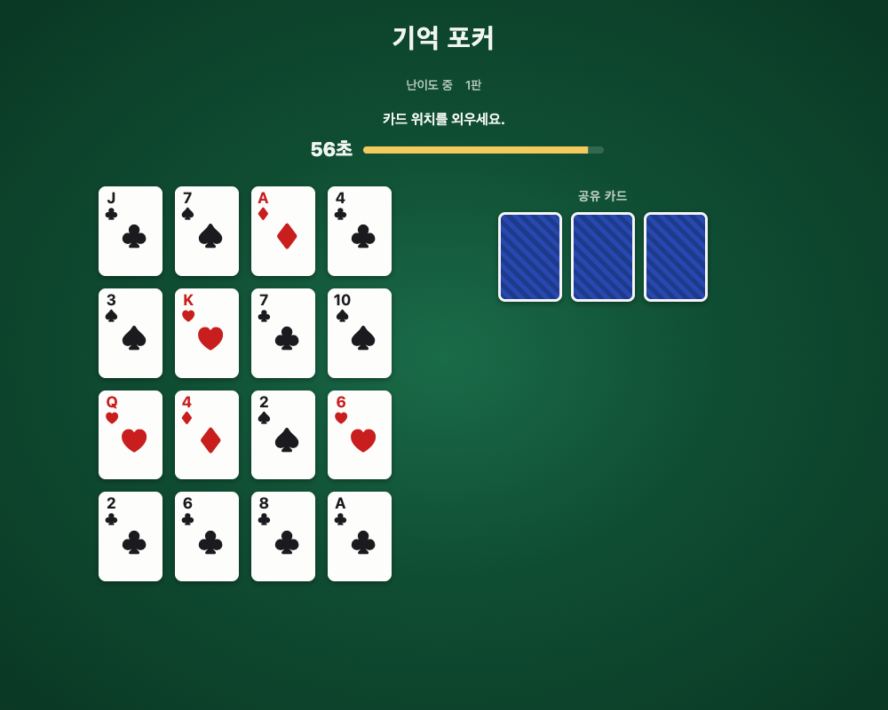

# 기억 포커

16장의 카드 위치를 60초 동안 외운 뒤, 기억만으로 2장을 골라 컴퓨터와 포커 족보를 겨루는 웹 게임입니다.
데블스플랜 3: 데드 어게인의 "기억 포커"를 바탕으로 만들었습니다.

**플레이하기: https://imoo26.github.io/memory-poker/**

| 암기 (60초)                            | 선택 (30초)                          | 결과                                 |
| -------------------------------------- | ------------------------------------ | ------------------------------------ |
|  |  |  |

## 규칙 요약

1. **준비**: 난이도(하/중/상)를 고르고 새 게임을 시작합니다. "시작"을 누르면 암기 단계가 시작됩니다.
2. **암기 (60초)**: 4x4 보드에 놓인 16장의 앞면이 공개됩니다. 위치를 외우세요. 일찍 끝낼 수 없습니다.
3. **선택 (30초)**: 16장이 뒷면으로 뒤집히고 공유 카드 3장이 공개됩니다. 기억을 떠올려 A~P 중 2칸을 고르고 제출합니다.
   - 고른 칸의 앞면은 결과가 나올 때까지 보이지 않습니다.
   - 컴퓨터와 같은 칸을 골라도 됩니다.
   - 30초 안에 2칸을 고르지 못하면 패배합니다.
4. **판정**: 고른 2장 + 공유 카드 3장 = 5장으로 텍사스 홀덤 족보를 만들어 비교합니다. 키커까지 비교하고, 문양 간 우열은 없습니다.
5. **무승부**: 새 카드로 처음부터 다시 겨룹니다 (승부가 날 때까지).

컴퓨터는 카드를 모두 알고 있습니다. 가능한 120개 조합을 강도순으로 정렬한 뒤 난이도에 따라 상위 30%(상), 중간 40%(중), 하위 30%(하) 구간에서 무작위로 하나를 고릅니다.

전체 규칙: [docs/GAME_RULES.md](docs/GAME_RULES.md)

### 조작

- 마우스(터치)로 칸을 눌러 선택/해제, "제출" 버튼
- 키보드: **A~P** 키로 칸 선택/해제, **Enter**로 제출 (한글 입력 상태에서도 동작)
- 난이도별 전적(승/패)은 브라우저에 저장됩니다.

## 기술 스택

- **TypeScript** (strict, `noUncheckedIndexedAccess`)
- **pnpm workspaces** 모노레포
- **React 19 + Vite**, CSS Modules
- **Vitest** (엔진 족보 판정은 52장 중 5장 조합 2,598,960개 전수 검증 포함), ESLint, Prettier
- **GitHub Actions**: PR마다 타입 검사·린트·포맷·테스트(CI), main에 병합되면 GitHub Pages 배포

## 구조

```
packages/engine/   게임 로직 (순수 TypeScript, React·DOM·시간·난수에 의존하지 않음)
  src/card.ts        카드, 덱, 시드 기반 난수와 셔플
  src/evaluator.ts   족보 판정과 비교
  src/board.ts       보드 배치, 칸 라벨, 2칸 선택 평가
  src/ai.ts          컴퓨터 난이도
  src/game.ts        게임 상태 머신 (리듀서)
apps/web/          React UI. 엔진의 gameReducer를 useReducer로 연결
docs/              규칙(GAME_RULES.md)과 개발 로드맵(ROADMAP.md)
```

게임 규칙과 카드 공개 시점은 모두 엔진이 정하고, 웹은 엔진 상태를 그리고 액션을 보내기만 합니다.
엔진은 난수를 시드로 주입받으므로 같은 시드면 같은 게임이 재현됩니다.

## 실행 방법

Node.js LTS와 pnpm이 필요합니다.

```bash
pnpm install
pnpm dev          # 개발 서버 http://localhost:5173/
pnpm test         # 전체 테스트
pnpm typecheck    # 타입 검사
pnpm lint         # 린트
pnpm format       # Prettier
pnpm --filter web build    # 배포용 빌드 (apps/web/dist)
```

### 개발용 URL 옵션

함께 쓸 수 있습니다 (예: `http://localhost:5173/?fast&seed=42&dev`).

| 옵션       | 설명                                                                               |
| ---------- | ---------------------------------------------------------------------------------- |
| `?fast`    | 암기 5초, 선택 10초                                                                |
| `?seed=42` | 시드 고정. 같은 배치와 같은 컴퓨터 선택이 재현되어 무승부 → 재대결을 확인하기 쉬움 |
| `?dev`     | 시작 화면에 AI 구간 비율(상/하) 조정 패널                                          |

## 라이선스

[MIT](LICENSE)
